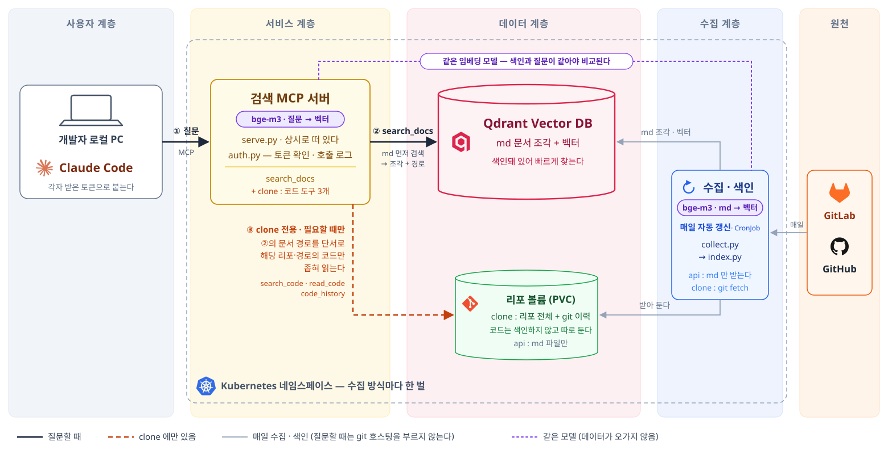

# rag-git-docs

> 팀의 Git 문서를 Vector DB 에 담아, Claude Code 가 우리 팀의 방식으로 답하게 하는 RAG 파이프라인. Claude Code 에는 검색 MCP 서버로 붙는다.

AI 는 기술의 일반적인 맥락에는 밝지만, 조직의 비즈니스 맥락은 알지 못한다.
같은 질문에도 "보통은 이렇게 한다"와 "우리는 이렇게 한다"는 다를 때가 많고, 실무에 필요한 답은 늘 후자다.

농담 반 진담 반으로, Git 은 경력 개발자의 뇌를 대체한다고 한다.
무엇을 왜 만들었는지, 장애 때 무엇을 했는지. 그 답은 사람의 기억이 아니라 리포의 문서와 코드, 커밋 이력에 남는다.
AI 가 모르는 조직의 맥락이 이미 거기 적혀 있다.

rag-git-docs 는 그 기록을 Claude Code 에 이어 준다.

- **알아서 찾는다.** 스킬처럼, 질문이 팀의 맥락에 닿으면 Claude 가 스스로 문서를 찾아 근거로 쓴다. 꼭 참조하게 하려면 "팀 문서 찾아보고", "git-docs 로" 한마디면 된다.
- **못 찾던 문서도 찾는다.** 리포마다 흩어진 수많은 md 에서, 정확한 단어가 기억나지 않아도 뜻으로 찾아 문서 경로와 날짜를 붙여 보여 준다.
- **필요하면 코드까지 본다.** 색인하는 것은 문서뿐이다. `clone` 모드에서는 문서로 답이 안 될 때만 코드와 커밋 이력을 직접 읽는다.

## 빠른 연결

운영자에게 MCP서버 주소와 본인 토큰을 받는다. 토큰을 환경변수에 두고 넘기면 명령 기록에 남지 않는다.

```bash
read -rsp "토큰: " t && echo "export GIT_DOCS_TOKEN=$t" >> ~/.bashrc && unset t    # 새 터미널부터 적용된다
claude mcp add --transport http --scope user git-docs http://<MCP서버 주소>/mcp \
  --header "Authorization: Bearer $GIT_DOCS_TOKEN"
```

Claude Code 의 `/mcp` 에 Connected 로 보이면 된다.

무엇을 물을 수 있나, 어떻게 답하나, 토큰을 새로 받았을 때는 [사용 가이드(docs/usage.md)](docs/usage.md)에 있다.

## 시스템 구조

쿠버네티스 네임스페이스 하나에 아래가 한 벌 뜬다. 진한 선은 질문할 때, 회색 선은 매일 수집·색인할 때의 흐름이고, 점선은 `clone` 방식에만 있다.



- **색인되는 것은 md 조각뿐이다.** 코드는 Qdrant 에 들어가지 않고, clone 일 때 MCP서버가 볼륨의 git 저장소를 직접 읽는다.
- **수집·색인과 MCP서버는 볼륨과 Qdrant 로만 이어진다.** 색인은 바뀐 문서의 조각만 새로 넣고 나서 옛 조각을 지우므로, 도는 동안에도 검색이 끊기지 않는다.
- **질문할 때는 git 호스팅을 부르지 않는다.** 호스팅에는 하루 한 번 수집할 때만 붙는다.

## 두 가지 수집 방식 — `api` 와 `clone`

무엇을 서버에 들여올지에 따라 두 방식이 있다. 둘의 차이는 기술보다 **보안과 품질 사이의 선택**이다.

| | `api` — md only | `clone` — 리포 전체 |
|---|---|---|
| 서버에 두는 것 | md 파일 | 리포 전체와 git 이력 |
| MCP서버 도구 | `search_docs` | `search_docs`, `search_code`, `read_code`, `code_history` |
| 얻는 것 | 서버가 새어도 유출 범위가 문서에서 그친다 | 코드와 이력을 근거로 답한다. 바뀐 것 받기·지우기·날짜를 git 이 맡는다 |
| 감수하는 것 | 코드로만 답할 수 있는 질문에는 답하지 못한다 | 서버에 코드와 이력(지운 시크릿 포함)의 사본이 생긴다 |

환경변수 `COLLECT_MODE` 로 고른다. 장단점 상세와 운영 방법은 [운영 가이드](docs/operations.md#수집-방식-고르기)에 있다.

## 서버에 설치하기 (운영자용)

팀이 함께 쓰는 MCP서버를 쿠버네티스에 Helm 으로 설치한다. 가장 짧은 경로는 이렇다.

```bash
helm package charts/rag-git-docs -d deploy/packages
helm install rag-qdrant deploy/packages/qdrant-1.19.1.tgz -n rag --create-namespace -f deploy/qdrant.values.yaml
cp deploy/rag-git-docs.secret.example.yaml deploy/rag-git-docs.secret.yaml    # SERVE_TOKEN 과 수집용 토큰을 채운다
helm install rag-git-docs deploy/packages/rag-git-docs-0.4.0.tgz -n rag -f deploy/rag-git-docs.values.yaml -f deploy/rag-git-docs.secret.yaml
```

이미지 빌드, values 에 채울 값, 업그레이드, 수집 방식 고르기, 토큰 관리, 로그는 [운영 가이드(docs/operations.md)](docs/operations.md)에 있다.

## 로컬 PC 에서 직접 설치·운영하기

서버 없이 자기 PC 에 전부 설치해 혼자 쓸 때만 해당한다. 이 프로젝트가 기본으로 상정한 사용법은 서버 하나에 여럿이 붙는 위의 [빠른 연결](#빠른-연결)이다.
절차는 [운영 가이드의 로컬 PC 절](docs/operations.md#로컬-pc-에서-직접-설치운영하기)에 있다.

## 문서

| 문서 | 읽는 사람 | 내용 |
|---|---|---|
| [docs/usage.md](docs/usage.md) | 쓰는 사람 | 연결, 물어볼 수 있는 것, 답하는 방식, 문제 해결 |
| [docs/operations.md](docs/operations.md) | 운영하는 사람 | 설치·업그레이드, 수집 방식, 토큰 관리, 네트워크, 로그, 로컬 실행 |
| [docs/design.md](docs/design.md) | 코드를 고치는 에이전트 | 설계 기록과 결정 이유 |
| [docs/proposal-git-clone.md](docs/proposal-git-clone.md) | 누구나 | clone 방식 검토 기록과 결정 사항 |

## 코드 구조

실행 파일 셋이 번호 순서로 돈다. 1·2 는 매일 한 번, 3 은 계속 떠 있다.
수집(`collector/`·`cloner/`)과 색인(`indexer/`)은 서로 import 하지 않는다. 둘을 잇는 것은 실행 파일뿐이다.

```
rag-git-docs/
├── CLAUDE.md             에이전트가 먼저 읽을 곳(docs/design.md)을 가리킨다
├── collect.py            1. COLLECT_MODE 를 보고 아래 둘 중 하나를 부른다
├── collect_api.py           api   md 파일만 API 로 DOCS_DIR 에 받는다                   → collector/
├── collect_clone.py         clone 리포를 이력까지 DOCS_DIR 에 git clone 해 두고 맞춘다  → cloner/ + collector/sources
├── index.py              2. DOCS_DIR 의 md 를 Qdrant 에 색인한다. 바뀐 조각만 임베딩한다. 수집 방식을 모른다 → indexer/
├── serve.py              3. MCP서버. Claude Code 의 질문으로 Qdrant 에서 관련 조각을 찾아 준다
│                            clone 이면 코드 도구(search_code, read_code, code_history)도 노출한다 → cloner/code.py
├── auth.py                  MCP서버의 사용자별 토큰 확인과, 누가 어떤 도구를 불렀는지 남기는 로그
│
├── collector/            api 방식. git 호스팅에서 md 를 내려받아 DOCS_DIR 에 둔다
│   ├── sources/          GitLab·GitHub API 호출. 호스팅마다 파일 하나. clone 도 리포 목록·인증은 여기서 받는다
│   │   ├── gitlab.py     그룹의 리포 목록, 리포 안 md 목록, md 내용, git 인증 정보를 준다
│   │   ├── github.py     계정의 리포에 대해 같은 일을 한다
│   │   ├── _http.py      HTTP GET 과 페이지 넘기기. 두 API 가 같은 방식이라 같이 쓴다
│   │   └── types.py      리포 정보(Repo)와, 파일 목록에서 md 만 골라내는 함수
│   ├── manifest.py       지난번에 받은 목록과 비교해 새로 받을 것, 지울 것을 정한다
│   └── files.py          md 를 DOCS_DIR 에 쓰고 지운다. 받은 목록을 .manifest.json 에 남긴다
│
├── cloner/               clone 방식. 리포를 git 으로 받아 두고, MCP서버가 그 코드를 읽는다
│   ├── git.py            clone·fetch 로 원격과 맞추고, md 마다 마지막 커밋일을 git log 로 구한다
│   ├── state.py          리포마다 맞춘 커밋 해시와 날짜를 .manifest.json 에 남긴다. 지울 clone 을 정한다
│   └── code.py           MCP서버의 코드 도구. clone 을 git grep·git show·git log 로 읽는다
│
├── indexer/              2 단계. md 를 잘라 벡터로 바꿔 Qdrant 에 넣는다
│   ├── chunk.py          md 를 헤딩마다 잘라 조각으로 만든다
│   ├── embed.py          조각을 임베딩 모델 bge-m3 로 벡터로 바꾼다
│   └── store.py          지금 md 의 조각과 Qdrant 를 비교해 새 조각만 넣고 사라진 조각을 지운다
│
├── charts/
│   └── rag-git-docs/     1·2·3 을 띄우는 Helm 차트 소스. 1·2 는 CronJob, 3 은 Deployment. values.yaml 은 기본값
├── deploy/               실제 배포 환경에 설치하는 값과 패키지
│   ├── packages/         설치할 차트 패키지. rag-git-docs 는 helm package 로 만들고, Qdrant 는 공식에서 받는다
│   ├── qdrant.values.yaml           Qdrant 차트 기본값 위에 덮어쓰는 이 환경의 값
│   ├── qdrant.clone.values.yaml     clone 모드 릴리스용 Qdrant 의 값. 이 파일 하나로 설치한다
│   ├── rag-git-docs.values.yaml     rag-git-docs 차트 기본값 위에 덮어쓰는 이 환경의 값
│   ├── rag-git-docs.clone.values.yaml   clone 모드 릴리스의 값. 이 파일 하나로 설치한다
│   └── rag-git-docs.secret.example.yaml   토큰 자리. 복사본은 git 에서 제외
├── infra/                서버 테라폼 (예정)
├── tests/                지울 파일 판정, md 자르기, 증분 색인, clone 기록과 git 동작 테스트
└── docs/
    ├── architecture.svg          시스템 구조도. README 의 "시스템 구조"에 보인다
    ├── usage.md                  사용 가이드. 연결·질문·답하는 방식·문제 해결
    ├── operations.md             운영 가이드. 설치·업그레이드·수집 방식·토큰 관리·네트워크·로그
    ├── design.md                 설계 기록. 에이전트가 코드를 고치기 전에 읽는다
    └── proposal-git-clone.md     clone 방식 검토 기록과 결정 사항
```

`serve.py` 는 `indexer/` 의 `embed.py` 와 `store.py` 를 가져다 쓴다.
질문을 문서와 비교하려면 색인 때와 같은 모델로 질문도 벡터로 바꿔야 하고, 색인과 같은 Qdrant 컬렉션을 읽어야 하기 때문이다.

## 왜 Qdrant 에 바로 붙지 않고 MCP서버를 거치나

- Qdrant 는 질문 텍스트가 아니라 벡터를 받는다
- 그 벡터는 색인 때와 같은 모델(bge-m3)로 만들어야 하는데, Claude Code 는 그 모델을 돌리지 못한다
- 그래서 MCP서버가 모델을 띄워 두고, 질문을 벡터로 바꿔 Qdrant 에 묻는다
- MCP 는 Claude Code 가 이런 서버를 도구로 불러 쓰게 하는 표준 규약이다

## 왜 Qdrant 공식 MCP 서버(mcp-server-qdrant)를 쓰지 않나

- 공식 서버는 bge-m3 를 쓸 수 없다. 색인과 다른 모델로 질문을 벡터로 바꾸면 비교가 안 된다
- 공식 서버는 dense 검색은 되지만 sparse 검색은 안 된다
  - dense 는 뜻으로 찾기 때문에 표현이 달라도 같은 내용을 찾아 준다 (다른 표현이어도 유사의미면 유사벡터값을 가짐)
  - 하지만 region-a1 과 region-a2 처럼 생김새도 뜻도 비슷한 단어는 같은 것으로 본다
  - sparse 는 단어 자체를 비교해서 이 둘을 구분한다
